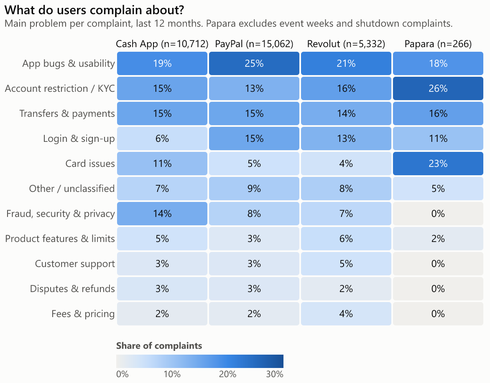
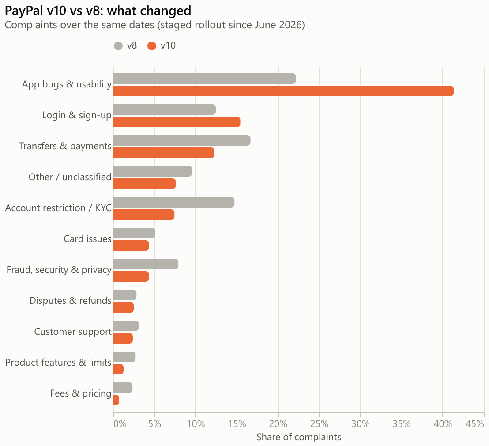
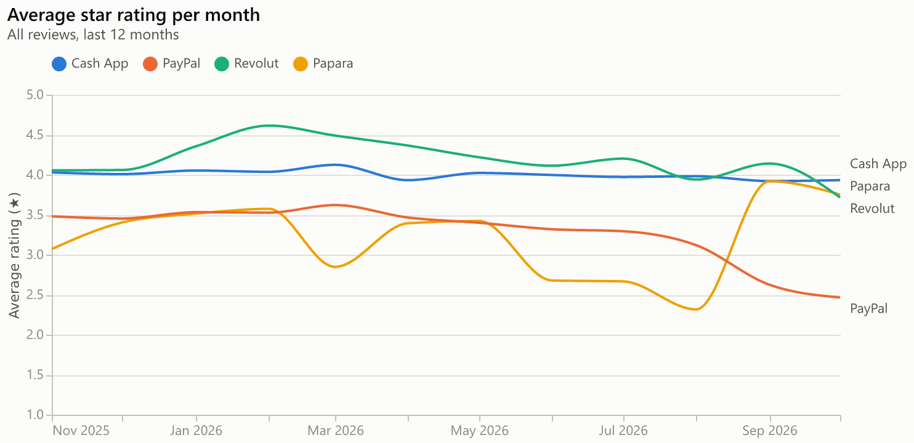
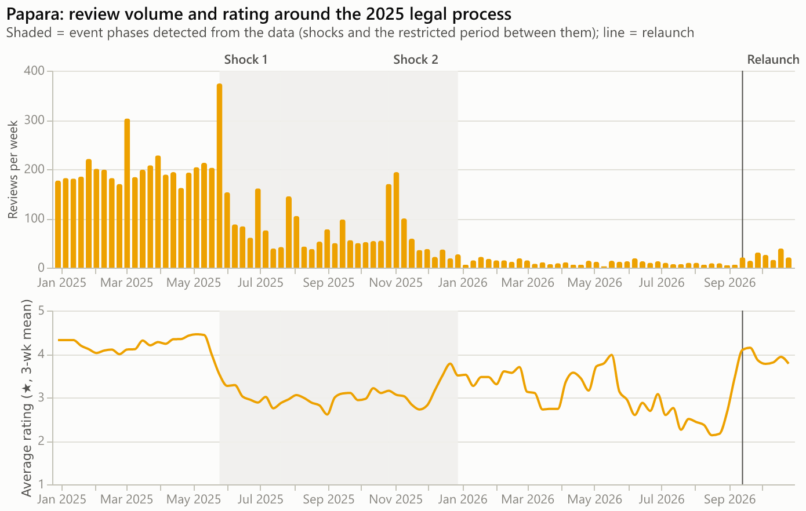
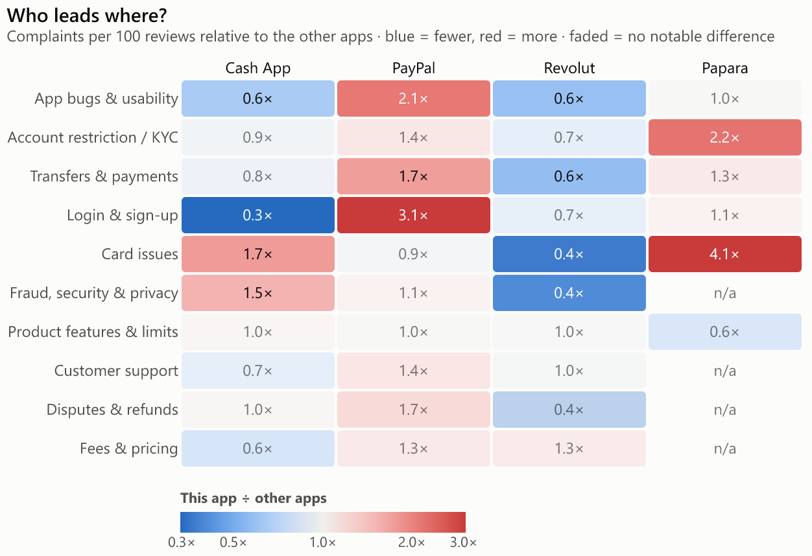
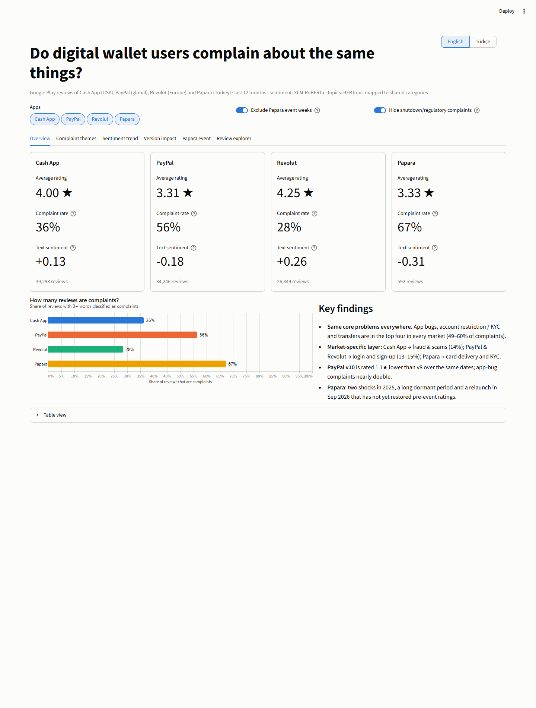
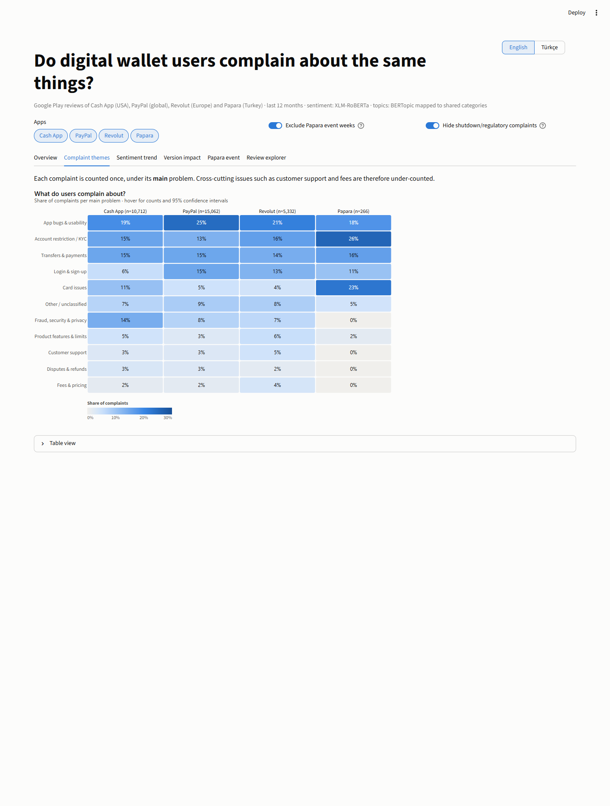
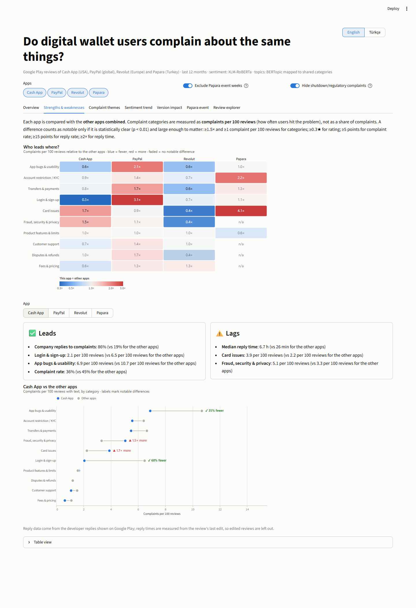
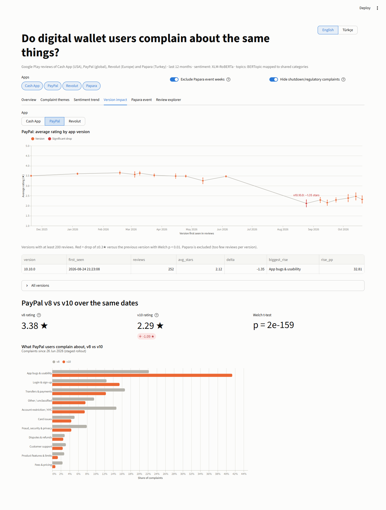
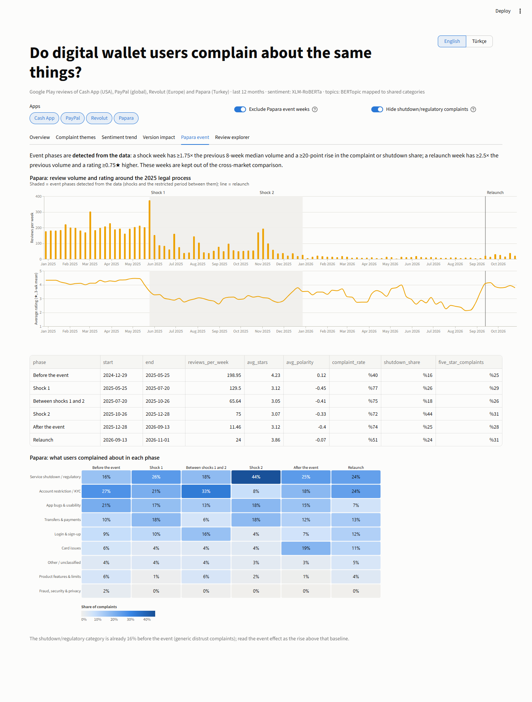

**English** | [Türkçe](README.tr.md)

# Digital Wallet Complaints Across Markets

**Question:** Do digital wallet users in different markets complain about the same things?

108,200 Google Play reviews of four digital wallet apps, analysed with a
multilingual sentiment model and BERTopic, with complaint topics mapped to
shared, language-independent categories so markets can be compared side by side.

| Market  | App      | Review language | Reviews (12 months) |
|---------|----------|-----------------|---------------------|
| USA     | Cash App | English         | 39,298 |
| Global  | PayPal   | English         | 34,246 |
| Europe  | Revolut  | English         | 26,849 |
| Turkey  | Papara   | Turkish         | 1,122 (+6,278 from 2025 for the event analysis) |

## Key findings

**1. Largely the same core problems, with a market-specific layer on top.**
App bugs, account restriction / KYC and transfers are in the top four in every
market and account for 49-60% of complaints. The category mix differs
statistically between the English-language apps (chi-square p ≈ 0), but the
effect is small (Cramér's V = 0.16). Differences are in the secondary
categories: **Cash App** has twice the share of fraud & scam complaints
(14% vs 7-8%); **PayPal** and **Revolut** have far more login & sign-up
complaints (13-15% vs 6%); **Papara** is dominated by KYC (NFC identity
checks, parental consent for under-18s) and card delivery.



**2. PayPal's v10 app is the clearest version effect.** v10 was rolled out
gradually from late June 2026, so v8 and v10 were in use at the same time.
Comparing them over the same dates removes seasonal and news effects:
v10 is rated **1.1 stars lower** (2.29 vs 3.38, n = 7,858, Welch p < 10⁻¹⁵⁰),
and app-bug complaints nearly double (22% → 41%). PayPal's monthly rating fell
from 3.6 to 2.5 stars over the same period.



**3. Ratings are stable for Cash App and mostly high for Revolut.** Cash App
holds ≈4.0 stars every month. Revolut peaks at 4.6 in February 2026 and drops
to 3.7 in October 2026, when releases 10.141 and 10.152 lose 0.7 and 1.0 stars
against their predecessors.



**4. Papara: the 2025 legal process, measured separately.** Event phases are
detected from the data, not set by hand. Two shocks (late May and late October
2025) cut the rating from 4.2 to about 3.1 stars and raised the complaint rate
from 40% to 72-77%. Volume then collapsed to about 11 reviews a week until a
relaunch in September 2026. The relaunch brought the rating back to 3.9 stars
and the complaint rate down to 51%, still worse than before the event. These
weeks are excluded from every cross-market comparison.



**5. Where each app leads or lags.** Comparing each app with the others
combined, on complaints per 100 reviews and on overall metrics (only
differences that are both significant and practically large count):

| App | Leads | Lags |
|---|---|---|
| Revolut | rating 4.25★, lowest complaint rate (28%), fastest replies (median 25 min), 40-63% fewer app-bug, card, fraud and transfer complaints | - |
| Cash App | replies to 86% of complaints (others 19%), 68% fewer login and 35% fewer app-bug complaints | 1.5× more fraud, 1.7× more card complaints, slower replies than Revolut |
| PayPal | - | replies to ~1% of complaints, 3.1× more login, 2.1× more app-bug, 1.7× more transfer complaints |
| Papara | - | 4.1× more card and 2.2× more KYC complaints, median reply time 21 h |



Full analysis: [`notebooks/analysis.ipynb`](notebooks/analysis.ipynb).

## Dashboard

An interactive Streamlit dashboard lets you pick apps and explore complaint
themes, sentiment trends, version impact, the Papara event and example reviews.
It is available in English and Turkish (language switch at the top right, or
`?lang=tr`).

```bash
streamlit run app/streamlit_app.py
```

| Overview | Complaint themes |
|---|---|
|  |  |
| **Strengths & weaknesses** | **Version impact** |
|  |  |
| **Papara event** | |
|  | |

## Project structure

```
src/
  collect_reviews.py      # Google Play scraper with resume support
  clean_reviews.py        # filtering rules and drop reasons
  preprocess.py           # English / Turkish text normalisation
  sentiment_models.py     # candidate models behind one interface
  sentiment_benchmark.py  # model comparison against star ratings
  sentiment.py            # scores all reviews with the chosen model
  taxonomy.py             # shared complaint categories
  topics.py               # BERTopic per language + category mapping
  analysis.py             # comparisons, trends, versions, event detection
  charts.py               # Altair charts used by the notebook and the dashboard
  i18n.py                 # English / Turkish strings for the dashboard and charts
  export_figures.py       # exports the README figures in a chosen language
config/                   # hand-reviewed topic -> category mappings
notebooks/analysis.ipynb  # analysis narrative (aggregates only, no review text)
app/streamlit_app.py      # dashboard
reports/                  # figures and benchmark results (topic review sheets with
                          # example reviews are generated locally and git-ignored)
data/                     # raw / interim / processed (git-ignored)
```

## How to run

Review texts are not included in this repository; the pipeline downloads them
again. Requires Python 3.12 (a CUDA GPU is optional but makes the sentiment
and embedding steps take minutes instead of hours).

```bash
python -m venv .venv
.venv\Scripts\activate          # Windows; use `source .venv/bin/activate` elsewhere
pip install -r requirements.txt

# 1. Collect: last 12 months for all apps, plus Papara back to 2025 for the event analysis
python -m src.collect_reviews --since 2025-10-31 --max-reviews 200000
python -m src.collect_reviews --apps papara --since 2025-01-01 --max-reviews 200000

# 2-4. Clean, score sentiment, model topics
python -m src.clean_reviews
python -m src.sentiment_benchmark   # optional: reproduces the model comparison
python -m src.sentiment
python -m src.topics fit            # writes reports/topics_<lang>.csv for review
python -m src.topics apply          # applies config/topic_mapping_<lang>.csv

# 5-6. Analysis and dashboard
jupyter nbconvert --to notebook --execute --inplace notebooks/analysis.ipynb
python -m src.export_figures --lang tr   # Turkish figures for README.tr.md
streamlit run app/streamlit_app.py
```

The collector pauses between requests and saves progress after every page,
so it can be stopped at any time and re-run to resume. Re-collecting at a
later date yields a different 12-month window, so numbers will shift; after
`topics fit`, re-check the topic mapping before `topics apply` (the script
refuses to run if topics are missing from the mapping).

## Cleaning

`src/clean_reviews.py` writes two tables to `data/processed/`:

- `reviews_all.parquet` - every review, with a `drop_reason` column (null = kept)
- `reviews_clean.parquet` - reviews used for text analysis

Reviews are dropped if they are empty, shorter than 3 words, spam (links,
contact details in fake-support scams, referral-code sharing, gibberish),
confidently written in a different language than the app's market, or
copy-pasted repeatedly. Each review keeps two text versions: `text`
(lightly cleaned, with casing and emojis, for transformer models) and
`text_norm` (lower-cased, emoji-free, abbreviations and contractions expanded,
Turkish characters restored in words typed without them, for keyword-based
topic representations).

## Sentiment analysis

**Model choice: one multilingual model (`cardiffnlp/twitter-xlm-roberta-base-sentiment`) for all markets.**

The choice was made empirically (`src/sentiment_benchmark.py`). Star ratings
served as weak labels (1-2 negative, 3 neutral, 4-5 positive) on a
star-stratified sample per language (1,500 English, 1,364 Turkish reviews):

| Model | Type | EN Spearman | EN binary F1 | TR Spearman | TR binary F1 |
|---|---|---|---|---|---|
| **XLM-R (twitter-xlm-roberta)** | multilingual, 3-class | 0.733 | 0.886 | **0.532** | **0.688** |
| mBERT (nlptown, 1-5 stars) | multilingual, review-trained | **0.787** | **0.904** | 0.419 | 0.633 |
| RoBERTa (twitter-roberta-latest) | English only | 0.757 | 0.900 | - | - |
| BERTurk (savasy) | Turkish only, binary | - | - | 0.521 | 0.657 |

- XLM-R is the best model on Turkish, beating even the Turkish-specific model,
  and within 2 F1 points of the best model on English.
- A single model measures sentiment on the same scale in every market, so
  differences between markets reflect the reviews rather than differences
  between models. A per-language combination would gain little on English
  while mixing two differently calibrated models.
- It also predicts a neutral class, which binary models cannot.
- Performance is consistent across Cash App, PayPal and Revolut (Spearman
  0.73-0.74), so the model is not biased towards one app.

The lower Turkish scores reflect noisy star labels more than model errors.
Many Papara reviews pair a 5-star rating with a complaint ("I gave 5 stars so
this shows at the top - my account has been closed for months") or with
sympathy during the 2025 legal process ("come back Papara"). The text-based
sentiment captures these cases, which is why it complements the star rating
rather than duplicating it.

## Topic modelling and shared complaint categories

**Complaints** are reviews with negative text sentiment, plus 1-2 star reviews
whose text is not positive (34,338 reviews). Including the second group
catches complaints hidden behind a high or neutral rating.

**One BERTopic model per language**: English (Cash App, PayPal and Revolut
share one model, so their topics are directly comparable; 67 topics) and
Turkish (Papara; 29 topics). Embeddings come from
`paraphrase-multilingual-mpnet-base-v2`; keywords from c-TF-IDF on the
normalised text.

**Brand masking.** In a first run, reviews clustered by *which app* they
mentioned rather than by the problem: a quarter of PayPal and of Cash App
complaints landed in one mixed, app-specific cluster each. Replacing brand
names with a neutral token before embedding fixed this (largest topic fell
from 26% of an app's complaints to 5.5% of all complaints).

**Mapping to shared categories.** Each topic was matched to a shared,
language-independent category (`src/taxonomy.py`). An embedding similarity
between topic centroids and category descriptions proposed a category; every
topic was then reviewed by hand using its keywords and example reviews, and
34 of 96 proposals were corrected (e.g. passport verification proposed as
"login" was reassigned to "Account restriction / KYC"). The final mapping is
versioned in `config/topic_mapping_<lang>.csv`, with a `manual_override`
column marking hand corrections.

**Limitation: one topic per review.** BERTopic assigns each review a single
dominant topic. Cross-cutting issues that usually appear *alongside* another
problem - most notably customer support ("my account was closed and support
never replies") and fees - are therefore under-counted; a quick keyword check
showed that only about 20% of complaints mentioning support fall into the
"Customer support" category. Category shares should be read as "the main
problem in a complaint", not as "how often an issue is mentioned". The effect
is strongest for Papara, whose smaller Turkish corpus produces coarser topics
in which support and fee complaints are absorbed into other topics.

## Analysis methods

- **Comparison scope.** Shared 12-month window (31 Oct 2025 - 31 Oct 2026);
  Papara weeks inside event phases are excluded. Shares are reported with
  Wilson 95% confidence intervals (dashboard tooltips).
- **Ratings vs text.** Star-rating trends use every review, including short
  ones, so the cleaning step does not bias them; text sentiment and complaint
  shares use reviews with 3+ words.
- **Version impact.** Versions with ≥200 reviews, ordered by first appearance;
  a *significant drop* is ≥0.3 stars below the previous version with Welch
  p < 0.01. Versions already live when the window opens are skipped (their
  first reviews come from users who never updated). For PayPal v8 vs v10, both
  groups are restricted to the dates when both versions were in use.
- **Papara event detection.** A *shock* week has ≥1.75× the median volume of
  the previous 8 weeks (and ≥50 reviews) and a ≥20-point rise in the complaint
  share or the shutdown/regulatory share; each shock opens an 8-week crisis
  window that later shocks can extend. A *relaunch* week, after the last
  crisis, has ≥2.5× the previous median volume and a rating ≥0.75 stars above
  the previous mean. The shutdown/regulatory category is already 16% before
  the event (generic distrust complaints), so the event effect is read as the
  rise above that baseline.

## Limitations

- One topic per complaint: customer support and fees are under-counted.
- Google Play reviewers are self-selected and skew towards extreme ratings.
- Papara's comparison sample is small (266 complaints outside event weeks).
- Google Play returns reviews by language more than by storefront, so
  "market" means the app's home market, not the reviewer's verified location.
