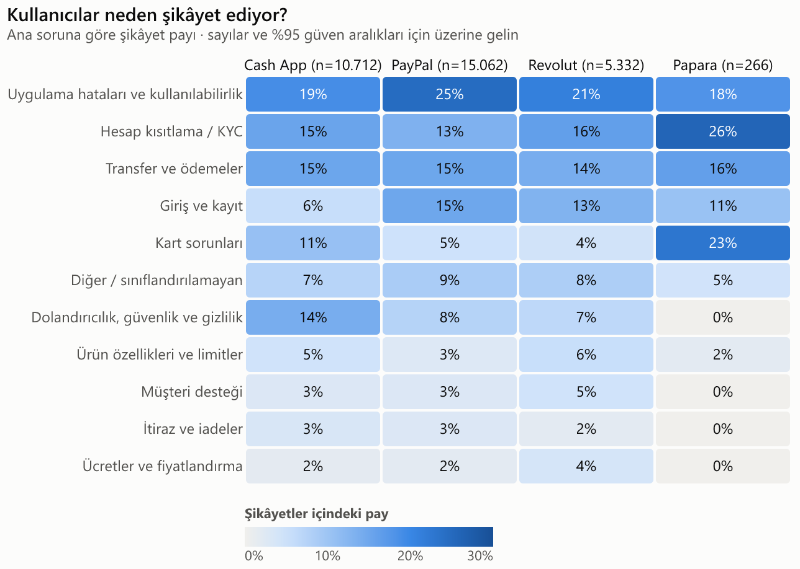
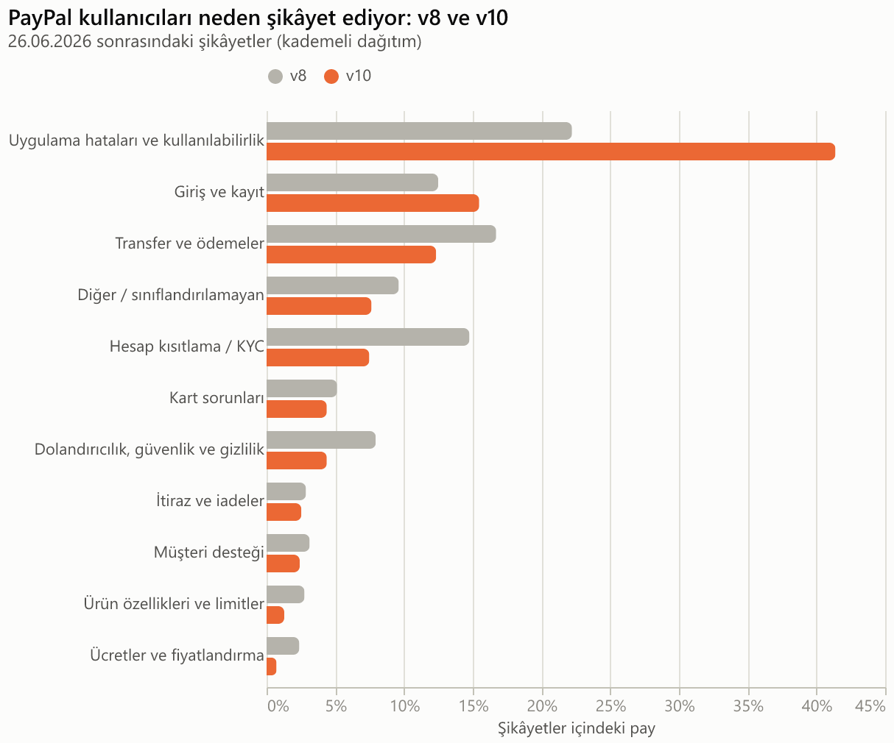
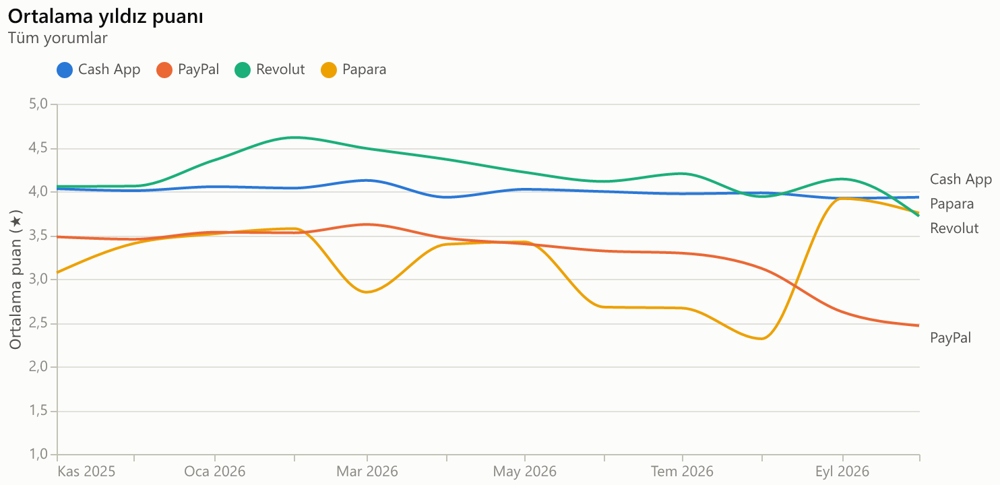
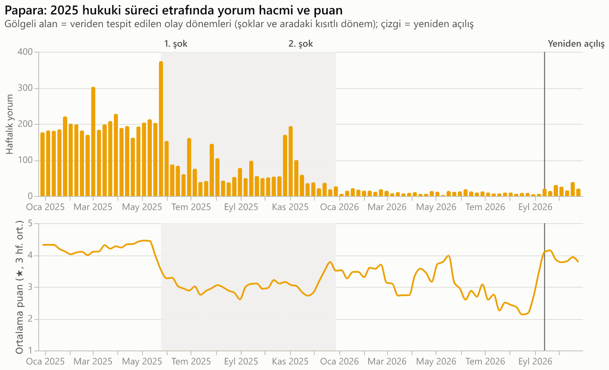
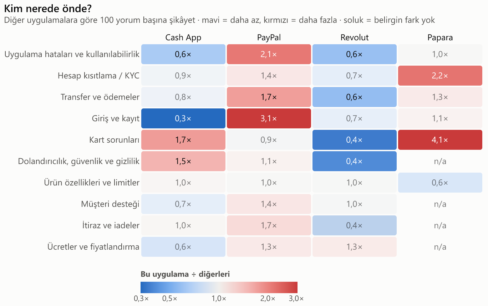
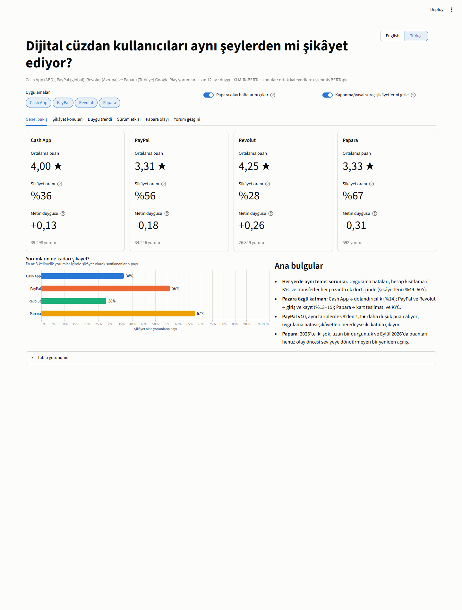
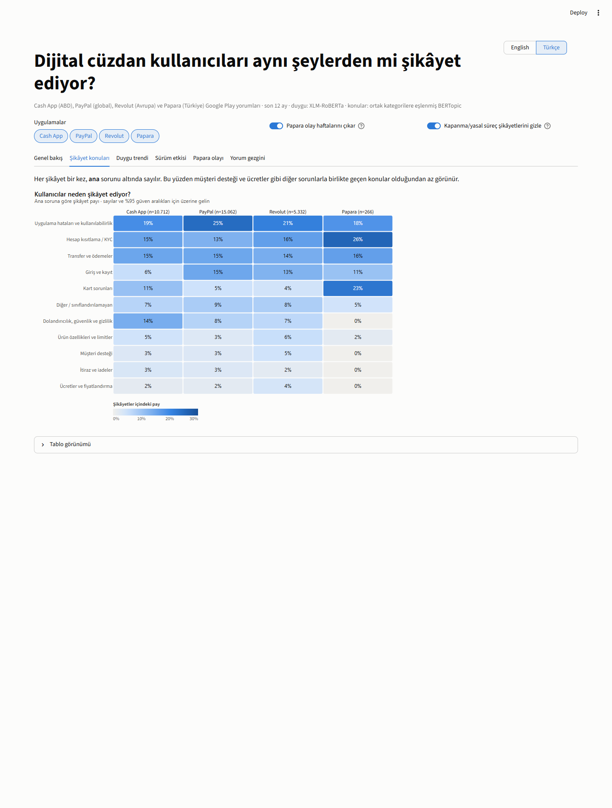
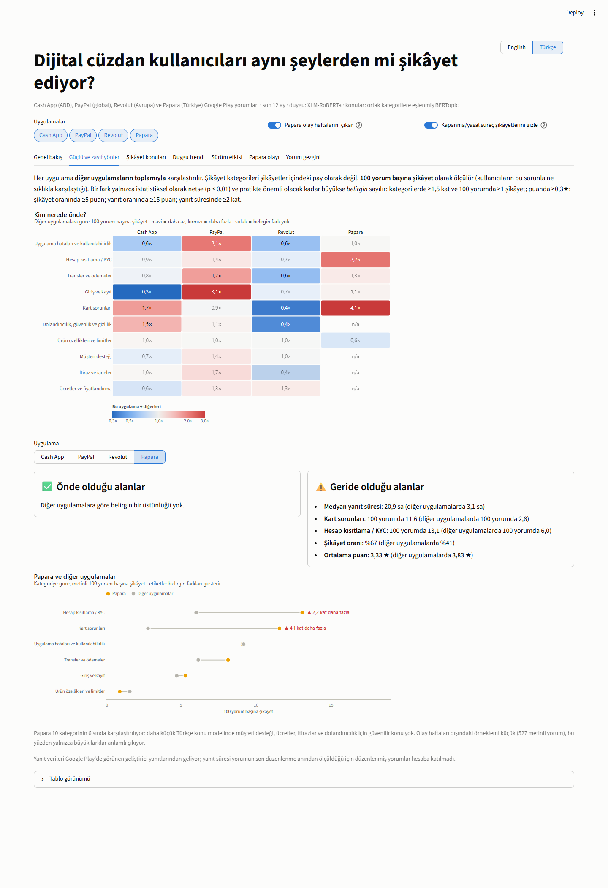
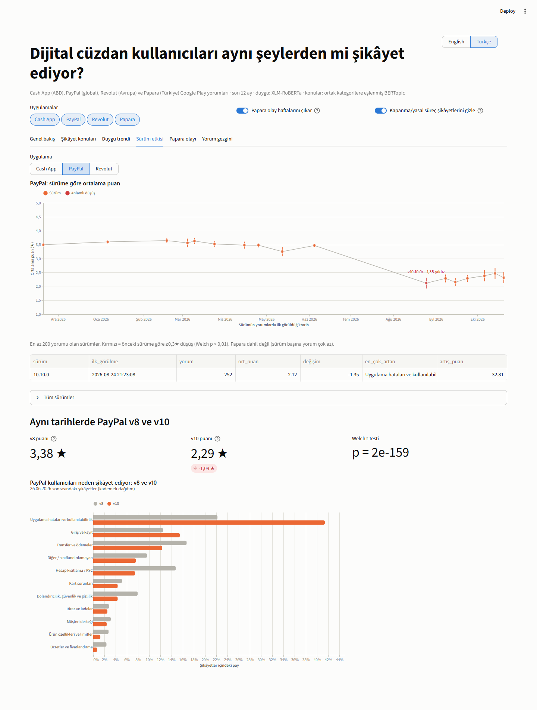
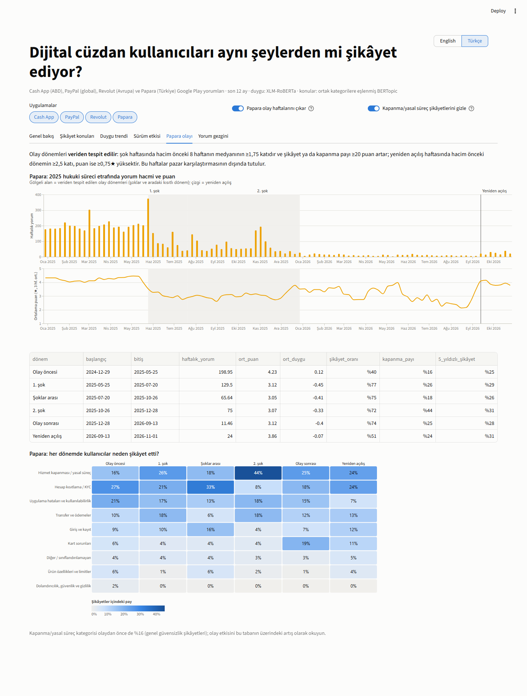

[English](README.md) | **Türkçe**

# Pazarlar Arası Dijital Cüzdan Şikâyetleri

**Soru:** Dijital cüzdan kullanıcıları farklı pazarlarda aynı şeylerden mi şikâyet ediyor?

Dört dijital cüzdan uygulamasının 108.200 Google Play yorumu, çok dilli bir
duygu analizi modeli ve BERTopic ile incelendi. Şikâyet konuları dilden
bağımsız ortak kategorilere eşlendi; böylece pazarlar yan yana karşılaştırılabiliyor.

| Pazar   | Uygulama | Yorum dili | Yorum (12 ay) |
|---------|----------|------------|---------------|
| ABD     | Cash App | İngilizce  | 39.298 |
| Global  | PayPal   | İngilizce  | 34.246 |
| Avrupa  | Revolut  | İngilizce  | 26.849 |
| Türkiye | Papara   | Türkçe     | 1.122 (+ olay analizi için 2025'ten 6.278) |

## Ana bulgular

**1. Büyük ölçüde aynı temel sorunlar, üstüne pazara özgü bir katman.**
Uygulama hataları, hesap kısıtlama / KYC ve transferler her pazarda ilk dört
içinde yer alıyor ve şikâyetlerin %49–60'ını oluşturuyor. İngilizce
uygulamalar arasında kategori dağılımı istatistiksel olarak farklı
(ki-kare p ≈ 0), ancak etki küçük (Cramér's V = 0,16). Farklar ikincil
kategorilerde: **Cash App**'te dolandırıcılık şikâyetlerinin payı diğerlerinin
iki katı (%14'e karşı %7–8); **PayPal** ve **Revolut**'ta giriş ve kayıt
şikâyetleri çok daha fazla (%13–15'e karşı %6); **Papara**'da KYC (NFC ile
kimlik doğrulama, 18 yaş altı için veli onayı) ve kart teslimatı öne çıkıyor.



**2. En net sürüm etkisi PayPal'ın v10 uygulamasında.** v10, Haziran 2026
sonundan itibaren kademeli olarak dağıtıldı; bu yüzden v8 ve v10 bir süre aynı
anda kullanıldı. İkisini aynı tarihlerde karşılaştırmak mevsimsel etkileri ve
haber etkilerini ortadan kaldırıyor: v10 **1,1 yıldız daha düşük** puan alıyor
(3,38'e karşı 2,29; n = 7.858; Welch p < 10⁻¹⁵⁰) ve uygulama hatası
şikâyetleri neredeyse iki katına çıkıyor (%22 → %41). Aynı dönemde PayPal'ın
aylık puanı 3,6'dan 2,5'e düştü.



**3. Cash App'te puanlar istikrarlı, Revolut'ta çoğunlukla yüksek.** Cash App
her ay ≈4,0 yıldızda kalıyor. Revolut Şubat 2026'da 4,6 ile zirve yapıyor ve
Ekim 2026'da 3,7'ye düşüyor; bu dönemde 10.141 ve 10.152 sürümleri, kendilerinden
önceki sürümlere göre 0,7 ve 1,0 yıldız kaybediyor.



**4. Papara: 2025 hukuki süreci ayrı ölçüldü.** Olay dönemleri elle
belirlenmedi, veriden tespit edildi. İki şok (Mayıs sonu ve Ekim sonu 2025)
puanı 4,2'den yaklaşık 3,1 yıldıza düşürdü ve şikâyet oranını %40'tan
%72–77'ye çıkardı. Ardından hacim, Eylül 2026'daki yeniden açılışa kadar
haftada yaklaşık 11 yoruma indi. Yeniden açılışla puan 3,9 yıldıza çıktı ve
şikâyet oranı %51'e indi; ancak ikisi de olay öncesinden hâlâ kötü. Bu haftalar
bütün pazar karşılaştırmalarının dışında tutuldu.



**5. Hangi uygulama nerede önde, nerede geride?** Her uygulama diğerlerinin
toplamıyla, 100 yorum başına şikâyet ve genel göstergeler üzerinden
karşılaştırıldı (yalnızca hem istatistiksel olarak anlamlı hem de pratikte büyük
farklar sayıldı):

| Uygulama | Önde | Geride |
|---|---|---|
| Revolut | 4,25★ puan, en düşük şikâyet oranı (%28), en hızlı yanıt (medyan 25 dk), uygulama hatası, kart, dolandırıcılık ve transfer şikâyetlerinde %40–63 daha az | - |
| Cash App | şikâyetlerin %86'sına yanıt (diğerleri %19), %68 daha az giriş ve %35 daha az uygulama hatası şikâyeti | 1,5 kat daha fazla dolandırıcılık, 1,7 kat daha fazla kart şikâyeti, Revolut'tan yavaş yanıt |
| PayPal | - | şikâyetlerin yalnızca ~%1'ine yanıt, 3,1 kat daha fazla giriş, 2,1 kat daha fazla uygulama hatası, 1,7 kat daha fazla transfer şikâyeti |
| Papara | - | 4,1 kat daha fazla kart ve 2,2 kat daha fazla KYC şikâyeti, medyan yanıt süresi 21 saat |



Analizin tamamı (İngilizce): [`notebooks/analysis.ipynb`](notebooks/analysis.ipynb).

## Dashboard

Etkileşimli Streamlit dashboard'unda uygulama seçerek şikâyet konularını, duygu
trendlerini, sürüm etkisini, Papara olayını ve örnek yorumları
inceleyebilirsiniz. Dashboard İngilizce ve Türkçe kullanılabiliyor (sağ üstteki
dil seçici ya da `?lang=tr` bağlantısı).

```bash
streamlit run app/streamlit_app.py
# Türkçe: http://localhost:8501/?lang=tr
```

| Genel bakış | Şikâyet konuları |
|---|---|
|  |  |
| **Güçlü ve zayıf yönler** | **Sürüm etkisi** |
|  |  |
| **Papara olayı** | |
|  | |

## Proje yapısı

```
src/
  collect_reviews.py      # kaldığı yerden devam edebilen Google Play toplayıcı
  clean_reviews.py        # filtreleme kuralları ve eleme nedenleri
  preprocess.py           # İngilizce / Türkçe metin normalleştirme
  sentiment_models.py     # aday modeller, ortak arayüz
  sentiment_benchmark.py  # modellerin yıldız puanlarıyla karşılaştırılması
  sentiment.py            # seçilen modelle tüm yorumların puanlanması
  taxonomy.py             # ortak şikâyet kategorileri
  topics.py               # dil başına BERTopic + kategori eşleme
  analysis.py             # karşılaştırmalar, trendler, sürümler, olay tespiti
  charts.py               # notebook ve dashboard'un ortak Altair grafikleri
  i18n.py                 # dashboard ve grafikler için İngilizce / Türkçe metinler
  export_figures.py       # README grafiklerini seçilen dilde dışa aktarır
config/                   # elle kontrol edilmiş konu -> kategori eşlemeleri
notebooks/analysis.ipynb  # analiz anlatımı (yalnızca toplu sonuçlar, yorum metni yok)
app/streamlit_app.py      # dashboard
reports/                  # grafikler ve karşılaştırma sonuçları (örnek yorum içeren
                          # konu inceleme dosyaları yerelde üretilir, git'e girmez)
data/                     # raw / interim / processed (git'e girmez)
```

## Nasıl çalıştırılır

Yorum metinleri bu repoda yer almıyor; veri hattı onları yeniden indiriyor.
Python 3.12 gerekir. CUDA destekli bir GPU şart değil, ama duygu analizi ve
embedding adımlarını saatler yerine dakikalara indirir.

```bash
python -m venv .venv
.venv\Scripts\activate          # Windows; diğer sistemlerde `source .venv/bin/activate`
pip install -r requirements.txt

# 1. Toplama: tüm uygulamalar için son 12 ay, olay analizi için Papara 2025 başından
python -m src.collect_reviews --since 2025-10-31 --max-reviews 200000
python -m src.collect_reviews --apps papara --since 2025-01-01 --max-reviews 200000

# 2-4. Temizleme, duygu analizi, konu modelleme
python -m src.clean_reviews
python -m src.sentiment_benchmark   # isteğe bağlı: model karşılaştırmasını yeniden üretir
python -m src.sentiment
python -m src.topics fit            # inceleme için reports/topics_<dil>.csv yazar
python -m src.topics apply          # config/topic_mapping_<dil>.csv eşlemesini uygular

# 5-6. Analiz, grafikler ve dashboard
jupyter nbconvert --to notebook --execute --inplace notebooks/analysis.ipynb
python -m src.export_figures --lang tr   # bu README'nin Türkçe grafikleri
streamlit run app/streamlit_app.py
```

Toplayıcı istekler arasında bekler ve her sayfadan sonra ilerlemeyi kaydeder;
istediğiniz an durdurup yeniden çalıştırarak kaldığı yerden devam
ettirebilirsiniz. Veriyi daha sonraki bir tarihte yeniden toplamak farklı bir
12 aylık dönem verir, dolayısıyla sayılar değişir. `topics fit` sonrasında
`topics apply` çalıştırmadan önce konu eşlemesini yeniden kontrol edin
(eşlemede eksik konu varsa script çalışmayı reddeder).

## Temizleme

`src/clean_reviews.py`, `data/processed/` altına iki tablo yazar:

- `reviews_all.parquet` - her yorum, `drop_reason` (eleme nedeni) sütunuyla (boş = tutuldu)
- `reviews_clean.parquet` - metin analizinde kullanılan yorumlar

Boş olan, 3 kelimeden kısa olan, spam içeren (bağlantılar, sahte destek
dolandırıcılığındaki iletişim bilgileri, referans kodu paylaşımı, anlamsız
metin), uygulamanın pazarından farklı bir dilde yazıldığı yüksek güvenle
tespit edilen ya da tekrar tekrar kopyala-yapıştır yapılan yorumlar elenir.
Her yorumun iki metin hali tutulur: `text` (hafif temizlenmiş, büyük/küçük harf
ve emojiler korunmuş; transformer modelleri için) ve `text_norm` (küçük harfe
çevrilmiş, emojisiz, kısaltmaları açılmış, Türkçe karakter kullanılmadan
yazılmış kelimelerde Türkçe karakterleri geri getirilmiş; anahtar kelimeye
dayalı konu temsilleri için).

## Duygu analizi

**Model seçimi: bütün pazarlar için tek bir çok dilli model (`cardiffnlp/twitter-xlm-roberta-base-sentiment`).**

Seçim ölçüme dayanıyor (`src/sentiment_benchmark.py`). Yıldız puanları zayıf
etiket olarak kullanıldı (1–2 olumsuz, 3 nötr, 4–5 olumlu); her dil için
yıldızlara göre dengelenmiş bir örneklem alındı (1.500 İngilizce, 1.364 Türkçe yorum):

| Model | Tür | EN Spearman | EN ikili F1 | TR Spearman | TR ikili F1 |
|---|---|---|---|---|---|
| **XLM-R (twitter-xlm-roberta)** | çok dilli, 3 sınıf | 0,733 | 0,886 | **0,532** | **0,688** |
| mBERT (nlptown, 1–5 yıldız) | çok dilli, yorumlarla eğitilmiş | **0,787** | **0,904** | 0,419 | 0,633 |
| RoBERTa (twitter-roberta-latest) | yalnızca İngilizce | 0,757 | 0,900 | - | - |
| BERTurk (savasy) | yalnızca Türkçe, ikili | - | - | 0,521 | 0,657 |

- XLM-R Türkçede en iyi model; Türkçeye özel modeli bile geçiyor. İngilizcede
  ise en iyi modelden yalnızca 2 F1 puanı geride.
- Tek model, duyguyu her pazarda aynı ölçekle ölçer; böylece pazarlar
  arasındaki farklar modellerin farklılığından değil, yorumlardan kaynaklanır.
  Dil başına ayrı model kullanmak İngilizcede çok az kazanç sağlarken iki farklı
  kalibrasyona sahip modeli karıştırırdı.
- İkili modellerin yapamadığı nötr sınıfı da tahmin ediyor.
- Performansı Cash App, PayPal ve Revolut'ta tutarlı (Spearman 0,73–0,74);
  yani model bir uygulamaya karşı yanlı değil.

Türkçedeki düşük skorlar model hatasından çok yıldız etiketlerinin
gürültüsünü yansıtıyor. Birçok Papara yorumunda 5 yıldız bir şikâyetle
("üstte gözüksün diye 5 verdim, hesabım aylardır kapalı") ya da 2025 hukuki
sürecindeki bir sempatiyle ("geri dön Papara") birlikte veriliyor. Metne dayalı
duygu analizi bu durumları yakalıyor; bu yüzden yıldız puanını tekrar etmiyor,
onu tamamlıyor.

## Konu modelleme ve ortak şikâyet kategorileri

**Şikâyetler**, metin duygusu olumsuz olan yorumlar ile metni olumlu olmayan
1–2 yıldızlı yorumlardır (34.338 yorum). İkinci grup, yüksek ya da nötr bir
puanın arkasına gizlenmiş şikâyetleri de yakalıyor.

**Dil başına bir BERTopic modeli**: İngilizce (Cash App, PayPal ve Revolut tek
modeli paylaşıyor, böylece konuları doğrudan karşılaştırılabiliyor; 67 konu) ve
Türkçe (Papara; 29 konu). Embedding'ler
`paraphrase-multilingual-mpnet-base-v2` ile, anahtar kelimeler normalleştirilmiş
metin üzerinde c-TF-IDF ile çıkarıldı.

**Marka maskeleme.** İlk denemede yorumlar soruna göre değil, *hangi
uygulamadan* bahsettiklerine göre kümelendi: PayPal ve Cash App şikâyetlerinin
dörtte biri, her biri kendi uygulamasına özgü karışık bir kümede toplandı.
Embedding'den önce marka adlarını nötr bir ifadeyle değiştirmek bunu çözdü
(en büyük konu, bir uygulamanın şikâyetlerinin %26'sından tüm şikâyetlerin
%5,5'ine indi).

**Ortak kategorilere eşleme.** Her konu dilden bağımsız ortak bir kategoriye
eşlendi (`src/taxonomy.py`). Konu merkezleri ile kategori açıklamaları
arasındaki embedding benzerliği bir kategori önerdi; ardından her konu anahtar
kelimeleri ve örnek yorumlarıyla elle incelendi ve 96 öneriden 34'ü düzeltildi
(ör. "giriş sorunu" olarak önerilen pasaport doğrulaması "Hesap kısıtlama /
KYC" kategorisine taşındı). Son eşleme `config/topic_mapping_<dil>.csv`
dosyalarında; elle yapılan düzeltmeler `manual_override` sütunuyla işaretli.

**Sınırlama: her yoruma tek konu.** BERTopic her yoruma tek bir baskın konu
atar. Bu yüzden genellikle başka bir sorunla *birlikte* geçen konular, özellikle
müşteri desteği ("hesabım kapatıldı ve destek hiç cevap vermiyor") ve ücretler,
olduğundan az sayılıyor. Kısa bir anahtar kelime kontrolü, destekten bahseden
şikâyetlerin yalnızca yaklaşık %20'sinin "Müşteri desteği" kategorisine
düştüğünü gösterdi. Kategori payları "bir şikâyetin ana sorunu" olarak
okunmalı, "bir sorundan ne sıklıkla bahsedildiği" olarak değil. Etki en çok
Papara'da görülüyor: daha küçük Türkçe veri daha kaba konular üretiyor ve
destek ile ücret şikâyetleri başka konuların içinde kayboluyor.

## Analiz yöntemleri

- **Karşılaştırma kapsamı.** Ortak 12 aylık dönem (31 Ekim 2025 – 31 Ekim
  2026); olay dönemlerine düşen Papara haftaları hariç. Paylar Wilson %95 güven
  aralıklarıyla raporlanıyor (dashboard tooltip'lerinde).
- **Puan ve metin.** Yıldız puanı trendleri kısa yorumlar dahil tüm yorumları
  kullanır, böylece temizleme adımı onları yanlı hale getirmez; metin duygusu
  ve şikâyet payları en az 3 kelimelik yorumları kullanır.
- **Sürüm etkisi.** En az 200 yorumu olan sürümler, ilk görüldükleri tarihe
  göre sıralandı. *Anlamlı düşüş*, önceki sürüme göre ≥0,3 yıldız düşük ve
  Welch p < 0,01 demek. Dönem başladığında zaten yayında olan sürümler dahil
  edilmedi (ilk yorumları güncelleme yapmayan kullanıcılardan geliyor). PayPal
  v8 ve v10 karşılaştırmasında iki grup da iki sürümün aynı anda kullanıldığı
  tarihlerle sınırlandı.
- **Papara olay tespiti.** *Şok* haftasında hacim önceki 8 haftanın
  medyanının ≥1,75 katıdır (ve en az 50 yorum vardır) ve şikâyet payı ya da
  kapanma/yasal süreç payı ≥20 puan artar; her şok 8 haftalık bir kriz dönemi
  açar, sonraki şoklar bu dönemi uzatabilir. Son krizden sonraki *yeniden
  açılış* haftasında hacim önceki medyanın ≥2,5 katı, puan ise önceki
  ortalamadan ≥0,75 yıldız yüksektir. Kapanma/yasal süreç kategorisi olaydan
  önce de %16 (genel güvensizlik şikâyetleri); bu yüzden olay etkisi bu tabanın
  üzerindeki artış olarak okunuyor.

## Sınırlamalar

- Her şikâyete tek konu: müşteri desteği ve ücretler olduğundan az sayılıyor.
- Google Play yorumcuları kendi seçimiyle yorum yazıyor ve uç puanlara eğilimli.
- Papara'nın karşılaştırma örneklemi küçük (olay haftaları dışında 266 şikâyet).
- Google Play yorumları mağazadan çok dile göre döndürüyor; bu yüzden "pazar",
  yorumcunun doğrulanmış konumunu değil, uygulamanın ana pazarını ifade ediyor.
